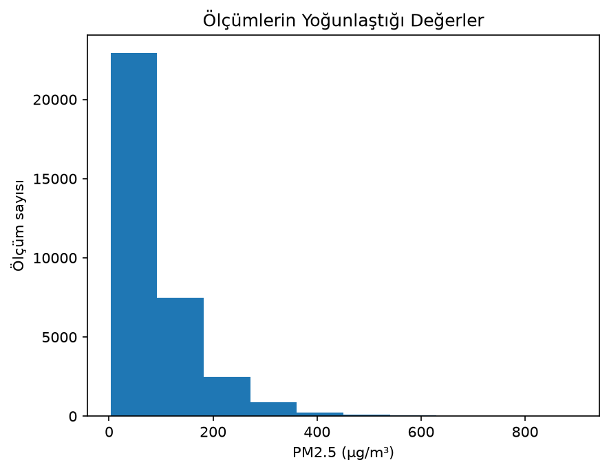
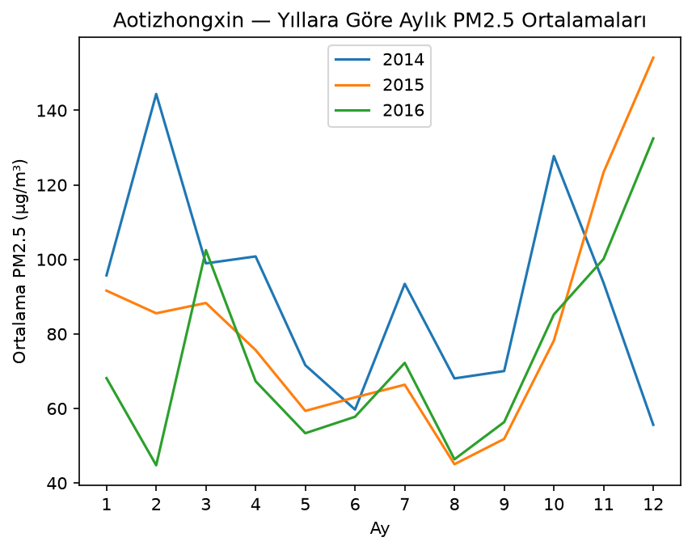
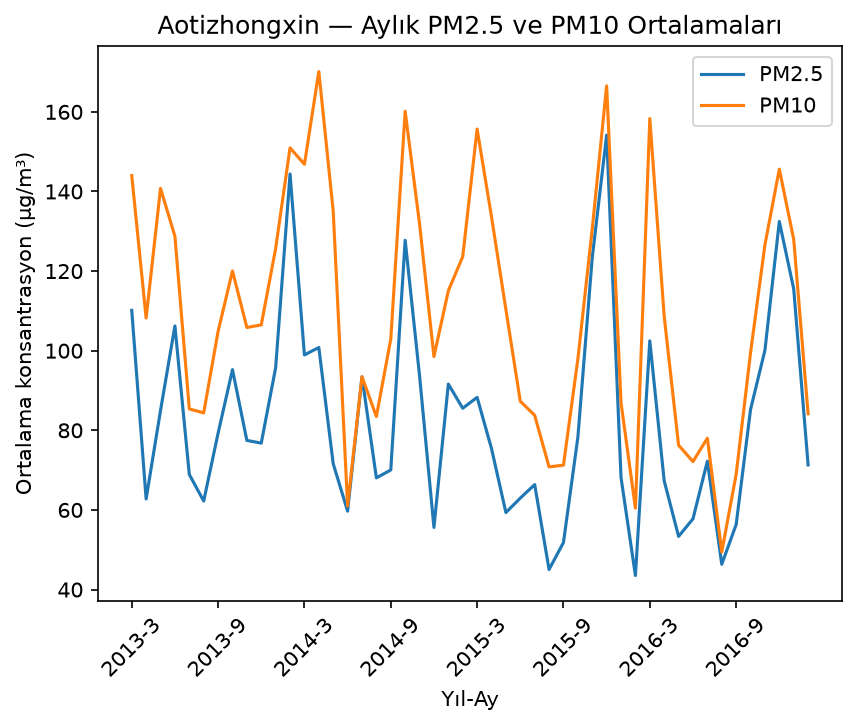

# Air Quality Intelligence

An exploratory data analysis project using **Pandas** and **Matplotlib** to study air quality at the **Aotizhongxin station in Beijing**.

This learning project covers data inspection, missing values, descriptive statistics, grouping, correlation, and visualization. It focuses on understanding the measurements; no machine learning model or forecasting is included. Code comments and chart labels are in Turkish, while this README is in English.

## Questions explored

- How are PM2.5 measurements distributed?
- How does average PM2.5 change across months and years?
- How is PM2.5 related to temperature and wind speed?
- How do PM2.5 and PM10 vary together?

## Dataset

Source: [UCI Beijing Multi-Site Air Quality dataset](https://archive.ics.uci.edu/dataset/501/beijing+multi+site+air+quality+data).

The source dataset covers 12 monitoring sites from **March 1, 2013 to February 28, 2017**. This project uses only the Aotizhongxin CSV, which contains **35,064 hourly records and 18 columns**. Meteorological observations in the source data are matched to nearby weather stations. [Dataset description](https://archive.ics.uci.edu/dataset/501/beijing+multi+site+air+quality+data).

Main variables used:

| Column | Meaning | Unit |
| --- | --- | --- |
| `PM2.5` | PM2.5 concentration | µg/m³ |
| `PM10` | PM10 concentration | µg/m³ |
| `TEMP` | Temperature | °C |
| `WSPM` | Wind speed | m/s |
| `year`, `month`, `day`, `hour` | Measurement time components | — |
| `station` | Monitoring station | — |
| `No` | Record number | — |

The column descriptions and units follow the [UCI documentation](https://archive.ics.uci.edu/dataset/501/beijing+multi+site+air+quality+data).

## Analysis and data preparation

1. Inspect the data structure, data types, missing values, and descriptive statistics.
2. Check duplicates using `year`, `month`, `day`, `hour`, and `station`. **No duplicates were found on this key**, so no duplicate rows were removed.
3. Examine the PM2.5 distribution with a histogram and a boxplot.
4. Compare PM2.5 with temperature and wind speed using scatter plots, correlations, and wind groups.
5. Calculate monthly means, medians, valid measurement counts, and missing percentages. Compare calendar months and the complete years 2014–2016.
6. Compare PM2.5 and PM10 using common observations, a scatter plot, correlation, and monthly averages.

### Missing values

The raw DataFrame is preserved. Missing measurements are not replaced with zero or an average, and high values are not automatically removed.

| Variable | Missing records |
| --- | ---: |
| PM2.5 | 925 |
| PM10 | 718 |
| TEMP | 20 |
| WSPM | 14 |

Each analysis uses the measurements it needs:

- **PM2.5 distribution and monthly summaries:** 34,139 available PM2.5 measurements. Monthly means and medians skip missing PM2.5 values.
- **Weather comparisons:** 34,119 records with PM2.5, TEMP, and WSPM all present. All weather plots, correlations, and wind groups use this same sample.
- **PM2.5–PM10 comparisons:** 34,130 records where both pollutant measurements are present.

Monthly missing percentages are calculated as `(record count - valid PM2.5 count) / record count × 100`. Record counts use the non-missing `No` column and refer to rows present in the file.

The calendar-month chart pools available hourly measurements from the same month across all years. The PM2.5–PM10 monthly comparison uses common records, so its PM2.5 averages can differ slightly from the standalone PM2.5 summary.

## Main findings

### PM2.5 has a long upper tail

The PM2.5 mean is **82.77 µg/m³**, while the median is **58.00 µg/m³**. Measurements are concentrated at lower values, with high observations pulling the mean upward. The maximum recorded PM2.5 value is **898.00 µg/m³**.



### Monthly patterns vary between years

When all years are pooled by calendar month, December has the highest average PM2.5 and August the lowest. However, winter months are not consistently high in every year. February 2014 averages **144.40 µg/m³**, while February 2016 averages **44.76 µg/m³**. December also differs substantially between 2014 and the following two years.



### Wind speed has a negative association with PM2.5

The following groups are exploratory choices for this project, not official wind categories. Their Turkish labels in the code are `Düşük`, `Orta`, and `Yüksek`.

| Wind group | Speed (m/s) | Mean PM2.5 (µg/m³) | Median PM2.5 (µg/m³) | Records |
| --- | --- | ---: | ---: | ---: |
| Low | < 1 | 103.80 | 80.00 | 9,158 |
| Medium | 1 to < 3 | 83.97 | 61.00 | 20,167 |
| High | ≥ 3 | 37.56 | 18.00 | 4,794 |

Both mean and median PM2.5 decrease across these wind groups.

### Correlation results

| Variables | Pearson correlation |
| --- | ---: |
| PM2.5 and temperature | -0.129 |
| PM2.5 and wind speed | -0.279 |
| PM2.5 and PM10 | 0.879 |

Temperature has a weak negative linear association with PM2.5. Wind speed also has a negative association, with a larger correlation magnitude. PM2.5 and PM10 have a strong positive linear association, although individual measurements do not follow a fixed proportion. These correlations use the analysis-specific samples described above.



## Project structure

```text
air-quality-intelligence/
├── analysis.py
├── README.md
├── requirements.txt
├── .gitignore
├── data/
│   └── raw/
│       └── PRSA_Data_Aotizhongxin_20130301-20170228.csv
└── outputs/
    └── 11 PNG charts generated by analysis.py
```

The script prints summary tables and saves the following charts in `outputs/`:

- `01_pm25_histogram.png`
- `02_pm25_boxplot.png`
- `03_temperature_pm25_scatter.png`
- `04_wind_pm25_scatter.png`
- `05_weather_correlation.png`
- `06_wind_group_comparison.png`
- `07_monthly_pm25.png`
- `08_calendar_month_comparison.png`
- `09_year_comparison.png`
- `10_pm25_pm10_scatter.png`
- `11_monthly_pm25_pm10.png`

## How to run

Tested with **Python 3.13.1**, **Pandas 3.0.6**, and **Matplotlib 3.11.1**. The two direct dependencies are pinned in `requirements.txt`.

1. If the station CSV is not already available, download the dataset from the [UCI source page](https://archive.ics.uci.edu/dataset/501/beijing+multi+site+air+quality+data). Extract the archive, including the inner ZIP if present, and place only `PRSA_Data_Aotizhongxin_20130301-20170228.csv` in `data/raw/`. The code does not download data automatically.
2. Ensure that the `outputs` directory exists. The script expects it to be present.
3. Open a terminal in the `air-quality-intelligence` project directory and install the dependencies:

   ```bash
   python -m pip install -r requirements.txt
   ```

4. Run the analysis:

   ```bash
   python analysis.py
   ```

If using PyCharm, select the Python interpreter containing these packages and set the run configuration's **Working directory** to the project directory. Input and output paths are relative to that directory.

With a standard interactive Matplotlib backend, close each chart window to continue to the next chart. Each image is saved before its window is shown. A complete run produces all 11 PNG files; running the script again replaces files with the same names.

## Limitations

- Results describe one station during the recorded period, not all of Beijing or current air quality.
- Missing measurements may affect comparisons. For example, August 2015 has approximately **7.80%** missing PM2.5 values; the effect on its mean cannot be determined from the missing percentage alone.
- Correlation and group comparisons do not establish causation. Other factors were not controlled for.
- Wind thresholds are chosen for exploration, and the groups have different numbers of observations.
- Monthly averages summarize many hourly readings and can hide short pollution peaks.
- High values were retained; this project does not independently validate measurement accuracy.

## Data attribution

Chen, S. (2017). *Beijing Multi-Site Air Quality* [Dataset]. UCI Machine Learning Repository. [https://doi.org/10.24432/C5RK5G](https://doi.org/10.24432/C5RK5G).

UCI lists the dataset under [Creative Commons Attribution 4.0 International (CC BY 4.0)](https://creativecommons.org/licenses/by/4.0/). See the [source license and citation](https://archive.ics.uci.edu/dataset/501/beijing+multi+site+air+quality+data). The raw station file is kept unchanged; this project selects records and creates summaries and charts from it. This attribution describes the dataset's license.
